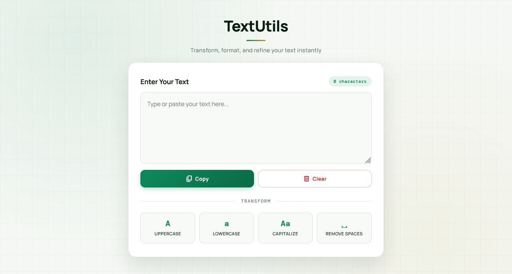

  

<h1 align="center">TextUtils</h1>

  A sleek, fully responsive text transformation tool built with vanilla JavaScript — featuring live character count, case conversion, whitespace cleanup, and a warm emerald aesthetic.

  
  

> Built while learning JavaScript.

---

## ✨ Features

- **Live character count** — updates instantly as you type
- **UPPERCASE** — convert entire text to uppercase
- **lowercase** — convert entire text to lowercase
- **Capitalize** — capitalize the first letter of each word
- **Remove extra spaces** — trim and collapse multiple spaces into one
- **Copy to clipboard** — with `Ctrl/Cmd + C` shortcut support
- **Clear with confirmation** — modal dialog prevents accidental deletion
- **Toast feedback** — "Copied!" state on the copy button
- **Esc key closes modal** — keyboard-friendly
- **Click-outside to close modal** — intuitive dismissal
- **Emerald + gold aesthetic** — warm cream background with soft glow orbs
- **Subtle grid background** — faint green blueprint lines
- **Fully responsive** — perfect on mobile (320px+), tablet, and desktop
- **Premium typography** — Manrope + DM Mono + Material Symbols

---

### 🔄 Transform Actions

| Button | Action |
|--------|--------|
| **UPPERCASE** | `text.toUpperCase()` |
| **lowercase** | `text.toLowerCase()` |
| **Capitalize** | `text.toLowerCase().split(' ').map(w => w[0].toUpperCase() + w.slice(1)).join(' ')` |
| **Remove Spaces** | `text.replace(/\s+/g, ' ').trim()` |

---

## ⌨️ Keyboard Shortcuts

| Shortcut | Action |
|----------|--------|
| `Ctrl/Cmd + C` (outside textarea) | Copy full text to clipboard |
| `Esc` | Close the clear-confirmation modal |

> When the textarea is focused, `Ctrl/Cmd + C` behaves natively (copies only selection).

---

## 🐛 Robustness

- **Empty text guard** — Copy and Capitalize do nothing if textarea is empty
- **Clipboard feedback** — button text changes to "Copied!" for 2 seconds
- **Copy timeout cleanup** — `clearTimeout` before setting a new one prevents flicker
- **Modal dismiss safety** — can close via Cancel, click-outside, or Esc key
- **Char count grammar** — correctly pluralizes ("1 character" / "2 characters")
- **Focus-aware copy** — native textarea copy is preserved when focused
- **Transform cascade** — each transform re-runs char count update

---

## 🔮 Future Ideas

- [ ] **Word count** — additional stat below character count
- [ ] **Sentence count** — count sentences in the text
- [ ] **Reading time estimate** — "about 2 min read"
- [ ] **Reverse text** — flip the string
- [ ] **Title Case** — proper title formatting
- [ ] **Download as .txt** — export the transformed text
- [ ] **Undo/Redo** — history stack for transformations
- [ ] **Word frequency** — show top 10 repeated words
- [ ] **Dark mode toggle**

---

## 🤝 Contributing

Contributions, issues, and feature requests are welcome!  
Feel free to check the [issues page](https://github.com/abdurrahman101bd/JavaScript/issues).

---

  Made with ❤️ while learning JavaScript

