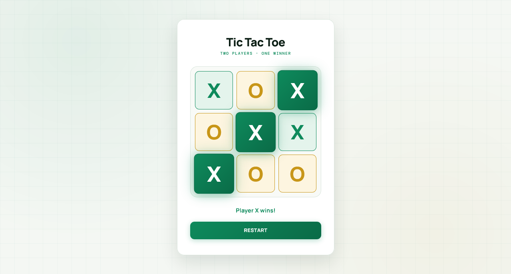

<p align="center">
  
</p>

<h1 align="center">Tic Tac Toe</h1>

<p align="center">
  A sleek, fully responsive Tic Tac Toe game built with vanilla JavaScript — featuring two-player gameplay, animated win states, confetti celebration, and a warm emerald aesthetic.
</p>

<p align="center">
  <a href="https://abdurrahman101bd.github.io/JavaScript/TicTacToe">
    
  </a>
  
</p>

> Built while learning JavaScript.

---

## ✨ Features

- **Classic two-player gameplay** — X vs O on a 3×3 grid
- **Turn indicator** — status text shows whose turn it is
- **Win detection** — all 8 win patterns checked after each move
- **Winner highlight** — winning cells glow with a pulsing gradient
- **Tie detection** — "It's a tie!" when the board fills up
- **Confetti celebration** — burst of confetti when someone wins (via tsparticles)
- **Restart button** — reset the board and start fresh anytime
- **Locked cells** — game becomes non-interactive after win/tie
- **Color-coded marks** — emerald X, gold O
- **Warm emerald aesthetic** — cream background with soft glow orbs
- **Subtle grid background** — faint green blueprint lines
- **Fully responsive** — perfect on mobile (320px+), tablet, and desktop
- **Premium typography** — Manrope + DM Mono

---

## 🎨 Design Highlights

| Element | Style |
|---------|-------|
| **Background** | Warm off-white `#f4f7f3` with subtle green grid |
| **Glow orbs** | Emerald `#0e8a5c` + gold `#c89618` (soft) |
| **Card** | White with rounded 20px corners + warm shadow |
| **Title** | Manrope extra-bold |
| **Subtitle** | DM Mono wide-caps in emerald |
| **Cell container** | Cream frame with 12px padding |
| **Cells** | White with 1.5px border, emerald hover |
| **X mark** | Emerald `#0e8a5c` on soft emerald bg |
| **O mark** | Gold `#c89618` on soft gold bg |
| **Win cells** | Gradient + pulse animation |
| **Restart button** | Emerald gradient with shine sweep |

---

## 🎨 Player Color Mapping

| Player | Color | Background |
|--------|-------|------------|
| **X** | Emerald `#0e8a5c` | Soft emerald `#e4f4ec` |
| **O** | Gold `#c89618` | Soft gold `#fdf5e0` |

**Win state** amplifies the color with a gradient + soft glow pulse.

---

## 🛠️ Tech Stack

| Technology | Usage |
|------------|-------|
| **HTML5** | Structure & semantic markup |
| **CSS3** | Grid layout, animations, responsive design (`clamp()`) |
| **JavaScript (Vanilla)** | Game logic, state management, DOM updates |
| **tsparticles/confetti** | Confetti celebration on win (via CDN) |
| **Google Fonts** | Manrope, DM Mono |

---

### 🧠 Win Patterns

```js
const winPatterns = [
  [0, 1, 2],
  [3, 4, 5],
  [6, 7, 8],
  [0, 3, 6],
  [1, 4, 7],
  [2, 5, 8], 
  [0, 4, 8],
  [2, 4, 6]             
];
```

---

## 🐛 Robustness

- **Empty cell check** — clicking a filled cell does nothing
- **Game-over guard** — locked cells block further input
- **Clean re-init** — event listeners removed and re-added on restart
- **Win detection** — all 8 patterns checked after every move
- **Tie detection** — board full without winner
- **Confetti fires** — only on win, not on tie
- **Win cells pulse** — subtle infinite pulse for celebration
- **Layered gradients** — X win = emerald gradient, O win = gold gradient

---

## 🔮 Future Ideas

- [ ] **AI opponent** — play against the computer (minimax)
- [ ] **Difficulty levels** — Easy / Medium / Hard
- [ ] **Score tracking** — track wins across rounds
- [ ] **Move history** — undo last move
- [ ] **Sound effects** — click + win chime
- [ ] **Best of 3 / 5** — series mode
- [ ] **Online multiplayer** — WebSocket-based
- [ ] **Dark mode toggle**

---

## 🤝 Contributing

Contributions, issues, and feature requests are welcome!  
Feel free to check the [issues page](https://github.com/abdurrahman101bd/JavaScript/issues).

---

<p align="center">
  Made with ❤️ while learning JavaScript
</p>