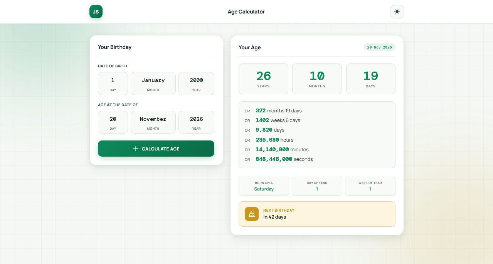

<p align="center">
  
</p>

<h1 align="center">Age Calculator</h1>

<p align="center">
  A sleek, fully responsive age calculator built with vanilla JavaScript — featuring day/month/year breakdown, total time lived, next birthday countdown, and a warm emerald aesthetic.
</p>

<p align="center">
  <a href="https://abdurrahman101bd.github.io/JavaScript/age-calculator">
    
  </a>
  
</p>

> Built while learning JavaScript.

---

## ✨ Features

- **Precise age breakdown** — years, months, and days since birth
- **Mobile-friendly date pickers** — custom day / month / year dropdowns (like an alarm clock)
- **Multiple time units** — total months, weeks, days, hours, minutes, and seconds lived
- **Birthday info** — day of the week, day of the year, and week of the year you were born
- **Next birthday countdown** — days until the next birthday
- **"Happy Birthday" mode** — celebration message if today is your birthday
- **Dark / light mode** — theme toggle with `localStorage` persistence
- **Empty state** — helpful prompt before calculation
- **Auto-validation** — prevents DOB from being after the target date
- **Fully responsive** — perfect on mobile (320px+), tablet, and desktop
- **Warm emerald aesthetic** — cream background with subtle grid pattern
- **Premium typography** — Manrope + DM Mono

---

## 🎨 Design Highlights

| Element | Style |
|---------|-------|
| **Background** | Warm off-white `#f4f7f3` with subtle green grid |
| **Glow orbs** | Emerald `#0e8a5c` + gold `#c89618` (soft) |
| **Navigation** | Sticky header with logo + theme toggle |
| **Layout** | Split-panel — input left, result right |
| **Panels** | White with rounded 20px corners + layered shadow |
| **Date pickers** | Custom 3-dropdown layout (day / month / year) |
| **Main age** | 3 large emerald numbers in cream blocks |
| **Detailed list** | Compact DM Mono numbers with "Or" labels |
| **Birthday info** | 3-card grid (day, week, day-of-year) |
| **Next birthday** | Gold-tinted card with cake icon |
| **Empty state** | Calendar icon + prompt |

---

### 🧠 Date Math Logic

Handling month/day borrow is the tricky part:

```js
if (days < 0) {
  months--;
  const prevMonth = new Date(ageAt.getFullYear(), ageAt.getMonth(), 0);
  days += prevMonth.getDate();
}

if (months < 0) {
  years--;
  months += 12;
}
```

Example: born **Dec 28, 2007** → target **Nov 9, 2026**:
- Years: `2026 - 2007 = 19`
- Months: `10 - 11 = -1` → **borrow** → years 18, months 11
- Days: `9 - 28 = -19` → **borrow** from October (31 days) → **12 days**
- Result: **18 years, 10 months, 12 days** ✅

---

## 🎂 Birthday Info Calculation

| Metric | Formula |
|--------|---------|
| **Day of Week** | `dob.getDay()` → 0 (Sunday) to 6 (Saturday) |
| **Day of Year** | `Math.floor((dob - Jan 0) / 1 day)` |
| **Week of Year** | `Math.ceil(dayOfYear / 7)` |
| **Next Birthday** | `new Date(year, dob.month, dob.day)`, add 1 year if past |

---

## ⌨️ Interaction

| Action | Result |
|--------|--------|
| **Select DOB** | Auto-day validation (Feb 30 → Feb 28/29) |
| **Click Calculate** | Full age breakdown displayed |
| **Click theme toggle** | Light ↔ dark mode with persistence |
| **Invalid DOB** | Alert prevents future dates |

---

## 🐛 Robustness

- **Month borrow** — correct handling for days-in-month edge cases
- **Leap year** — Feb 29 works correctly
- **Future date guard** — DOB > target date triggers alert
- **Auto day validation** — Feb shows 28/29 days depending on year
- **localStorage safety** — theme preference persists across sessions
- **`hidden` attribute fix** — `.empty-state[hidden] { display: none !important; }` prevents overlap
- **Safe date parsing** — explicit year/month/day construction (avoids timezone bugs)
- **Number formatting** — large totals use `toLocaleString()` for commas

---

## 🔮 Future Ideas

- [ ] **Zodiac sign** — western + Chinese zodiac from DOB
- [ ] **Birthstone** — gem associated with the birth month
- [ ] **Life milestones** — 10,000 days, 1 billion seconds, etc.
- [ ] **Birth chart** — natal astrology chart
- [ ] **Export as image** — download the result as PNG
- [ ] **Multiple people** — compare ages between two people
- [ ] **Countdown timer** — live-updating to the next birthday
- [ ] **Historical events** — what happened on your birthday

---

## 🤝 Contributing

Contributions, issues, and feature requests are welcome!  
Feel free to check the [issues page](https://github.com/abdurrahman101bd/JavaScript/issues).

---

<p align="center">
  Made with ❤️ while learning JavaScript
</p>