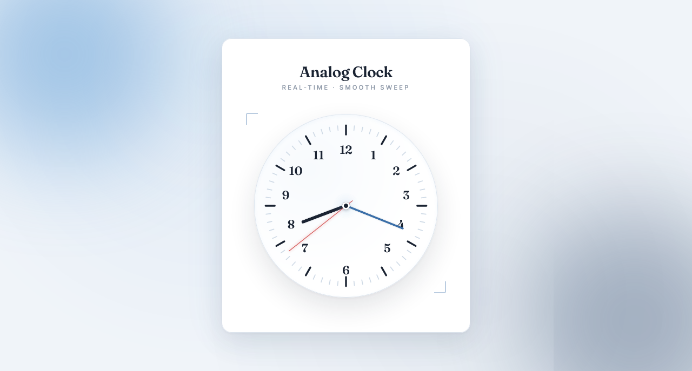

  

<h1 align="center">Analog Clock</h1>

  A sleek, fully responsive analog clock built with vanilla JavaScript — featuring smooth sweeping hands, editorial serif typography, and a coastal blue aesthetic.

  
  

> Built while learning JavaScript.

---

## ✨ Features

- **Pure analog clock** — no digital text, just a beautiful clock face
- **Smooth sweeping second hand** — `requestAnimationFrame` + millisecond accuracy for 60fps motion
- **Continuous hour & minute hands** — hands move gradually, not in jumps
- **SVG clock face** — 12 hour ticks, 60 minute ticks, and 12 numbers (no external image needed)
- **Coastal editorial aesthetic** — cool blue palette with off-white background
- **Glow orbs in background** — sky blue top-left + deep navy bottom-right, both animated
- **Editorial serif numbers** — Fraunces serif for elegant, warm feel
- **Ink-and-paper hands** — solid black hour hand, blue minute hand, thin red second hand
- **Corner brackets** — subtle editorial framing detail
- **Soft paper shadow** — multi-layer blue-tinted shadow under the card
- **Pulsing center glow** — radial blur behind the center breathes gently
- **Smooth hover bloom** — clock face gains a subtle blue glow on hover
- **Fully responsive** — perfect on mobile (320px+), tablet, and desktop
- **Premium typography** — Fraunces serif + Inter

---

### 📐 Angle Formula

| Hand | Formula |
|------|---------|
| **Second** | `seconds × 6°` |
| **Minute** | `(minutes + seconds/60) × 6°` |
| **Hour** | `((hours % 12) + minutes/60) × 30°` |

The continuous hour and minute hands use fractional values so they glide instead of snapping.

### ⏱️ Why `requestAnimationFrame`?

`setInterval` runs every 1000ms, which causes the second hand to **jump** and miss frames. `requestAnimationFrame` syncs with the browser's repaint cycle (~60fps), giving a **buttery smooth sweep** — like a real mechanical watch.

---

## 🐛 Robustness

- **Millisecond precision** — smooth hand motion without visible jumps
- **Continuous hour hand** — even on the hour, the hand is slightly past the mark
- **No external images** — SVG clock face is crisp at any DPI
- **Responsive sizing** — `clamp(240px, 72vw, 340px)` for perfect scaling
- **No intervals** — entire clock runs on a single `requestAnimationFrame` loop
- **Corner brackets hidden on mobile** — prevents clutter on small screens

---

## 🔮 Future Ideas

- [ ] **Tick sound** — soft click each second via Web Audio API
- [ ] **Second hand color toggle** — red / blue / ink
- [ ] **Rotating gradient ring** — outer border slowly spins
- [ ] **Stopwatch overlay** — secondary mode
- [ ] **Alarm** — set an alarm with browser notification
- [ ] **Dark mode** — inverted coastal theme
- [ ] **Custom themes** — switch palettes on the fly

---

## 🤝 Contributing

Contributions, issues, and feature requests are welcome!  
Feel free to check the [issues page](https://github.com/abdurrahman101bd/JavaScript/issues).

---

  Made with ❤️ while learning JavaScript

