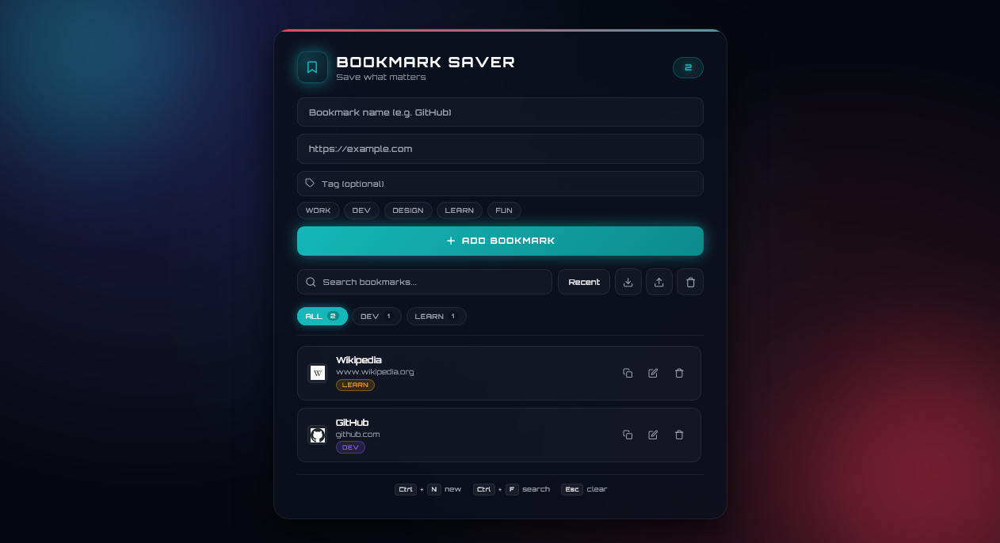

<p align="center">
  
</p>

<h1 align="center">Bookmark Saver</h1>

<p align="center">
  A sleek, fully responsive bookmark manager built with vanilla JavaScript — featuring live search, tags, drag-to-reorder, import/export, and a dark neon aesthetic.
</p>

<p align="center">
  <a href="https://abdurrahman101bd.github.io/JavaScript/bookmark-saver">
    
  </a>
  
</p>

> Built while learning JavaScript.

---

## ✨ Features

- **Save bookmarks** — name, URL, and optional tag
- **Auto URL prefix** — `example.com` becomes `https://example.com` automatically
- **Live search** — filter by name, URL, or tag as you type
- **Tags / categories** — preset buttons (Work, Dev, Design, Learn, Fun) + custom tags
- **Tag filter bar** — click a tag chip to filter, click again to unfilter
- **Sort options** — Recent / Name / URL / Custom
- **Drag to reorder** — reorder bookmarks in Custom sort mode (saved to localStorage)
- **Edit inline** — edit name, URL, and tag in place
- **Delete bookmark** — with a themed confirm dialog
- **Clear all** — bulk delete with confirmation
- **Auto favicon** — fetched per domain from Google (with letter fallback)
- **Copy URL** — one-click copy per bookmark
- **Duplicate detection** — prevents duplicate names or URLs
- **Import / Export** — backup all bookmarks as JSON
- **Smart merge on import** — skips duplicates automatically
- **Keyboard shortcuts** — Ctrl/Cmd+N (new), Ctrl/Cmd+F (search), Esc (clear)
- **Count badge** — live bookmark count with bump animation
- **Empty states** — helpful messages when no bookmarks or no matches
- **Toast notifications** — success/error feedback for every action
- **Fully responsive** — perfect on mobile (320px+), tablet, and desktop
- **Premium typography** — Orbitron font with glow effects
- **Dark neon theme** — floating glow orbs + glassmorphism card

---

## 🛠️ Tech Stack

| Technology | Usage |
|------------|-------|
| **HTML5** | Structure & semantic markup |
| **CSS3** | Glassmorphism, animations, responsive layout (`clamp()`, grid, flexbox) |
| **JavaScript (Vanilla)** | DOM updates, state management, drag & drop API |
| **localStorage** | Persistent bookmark storage |
| **FileReader API** | JSON import |
| **Blob API** | JSON export |
| **Google Favicon API** | Auto-fetch bookmark icons |
| **Google Fonts** | Orbitron |

---


## ⌨️ Keyboard Shortcuts

| Shortcut | Action |
|----------|--------|
| `Ctrl/Cmd + N` | Focus name input (ready for new bookmark) |
| `Ctrl/Cmd + F` | Focus search field |
| `Ctrl/Cmd + K` | Focus search field (alternative) |
| `Esc` | Close edit → clear search → clear tag filter |
| `Enter` (in form) | Add bookmark |

> Mac users automatically get `Cmd` instead of `Ctrl` — detected via `navigator.platform`.

---

## 🏷️ Tags

Preset tags with distinct colors:

| Tag | Color |
|-----|-------|
| **Work** | Cyan `#15b7b9` |
| **Dev** | Purple `#8b5cf6` |
| **Design** | Pink `#ff3b5c` |
| **Learn** | Amber `#f59e0b` |
| **Fun** | Green `#22c55e` |

**Custom tags** are auto-assigned a color using hash-based selection from a 7-color palette.

Tags appear as:
1. **Badge** on each bookmark item
2. **Filter chips** in the tag filter bar with counts
3. **Click to filter** by tag, click again to unfilter

---

## 🖱️ Drag to Reorder

1. Set sort mode to **Custom**
2. A drag handle appears on each bookmark
3. Drag any bookmark to reorder
4. Order is saved to `localStorage` automatically
5. Visual feedback: dragging item fades, drop target gets dashed border

---


## 💾 Data Format

Exported JSON:

```json
[
  {
    "id": "bm_1734532800000_abc123",
    "name": "GitHub",
    "url": "https://github.com",
    "tag": "Dev",
    "addedAt": 1734532800000,
    "order": 0
  }
]
```

Import skips:
- ❌ Duplicates (same name or URL)
- ❌ Invalid entries (missing name or URL)
- ✅ Valid, unique entries are merged into your existing list

---

## 🐛 Robustness

- **Auto URL prefix** — `example.com` → `https://example.com`
- **URL validation** — uses native `URL` constructor
- **Duplicate detection** — case-insensitive name or URL match
- **localStorage safety** — try/catch wrappers
- **Favicon fallback** — letter badge if image fails
- **Import validation** — filters invalid entries before merge
- **Confirm dialogs** — prevents accidental deletion

---

## 🔮 Future Ideas

- [ ] **Bookmark folders** — nested categorization
- [ ] **Cloud sync** — login-based sync across devices
- [ ] **Bulk select** — multi-delete / multi-tag
- [ ] **Dark / light theme** toggle
- [ ] **Bookmark metadata** — title auto-fetch from URL
- [ ] **Notes per bookmark** — additional context
- [ ] **Chrome extension** — right-click to save any page
- [ ] **PWA** — install as desktop/mobile app

---

## 🤝 Contributing

Contributions, issues, and feature requests are welcome!  
Feel free to check the [issues page](https://github.com/abdurrahman101bd/JavaScript/issues).

---


<p align="center">
  Made with ❤️ while learning JavaScript
</p>