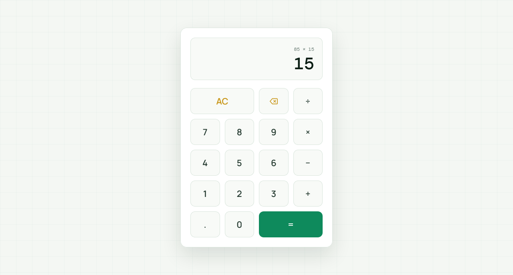

  

<h1 align="center">Calculator</h1>

  A sleek, fully responsive web calculator built with vanilla JavaScript — featuring full arithmetic operations, keyboard support, and a warm emerald aesthetic.

  
  

> Built while learning JavaScript.

---

## ✨ Features

- **Full arithmetic operations** — addition, subtraction, multiplication, division
- **Live history display** — shows the current expression above the result
- **Keyboard support** — numbers, operators, Enter, Backspace, Escape all work
- **Decimal support** — handles floating-point math correctly
- **Division by zero guard** — shows "Error" instead of crashing
- **Delete button** — removes the last digit
- **Clear (AC)** — resets everything to zero
- **Auto-chaining** — pressing an operator after a result continues the calculation
- **Fully responsive** — perfect on mobile (320px+), tablet, and desktop
- **Warm emerald aesthetic** — cream background with soft grid pattern
- **Premium typography** — Manrope (UI) + DM Mono (numbers)

---

## 🎨 Design Highlights

| Element | Style |
|---------|-------|
| **Background** | Warm off-white `#f4f7f3` with subtle green grid |
| **Calculator card** | White with rounded 16px corners + layered shadow |
| **Display** | Cream inset with DM Mono numbers |
| **History** | Small muted DM Mono text above the result |
| **Number buttons** | Cream with subtle border |
| **Operator buttons** | Emerald accent |
| **AC / Delete** | Gold accent |
| **Equal button** | Emerald gradient (primary CTA) |
| **Hover effects** | Soft lift + border darken |
| **Active state** | Scale down to 0.95 |

---

## ⌨️ Keyboard Shortcuts

| Key | Action |
|-----|--------|
| `0-9` | Type digits |
| `.` | Add decimal point |
| `+` | Addition |
| `-` | Subtraction |
| `*` | Multiplication |
| `/` | Division |
| `Enter` / `=` | Calculate result |
| `Backspace` | Delete last digit |
| `Escape` | Clear everything |

---

## 🔮 Future Ideas

- [ ] **Scientific mode** — sin, cos, tan, log, sqrt
- [ ] **Percentage button** — calculate discounts
- [ ] **Memory (M+, M-, MR, MC)** — store intermediate values
- [ ] **Calculation history log** — scrollable list of past operations
- [ ] **Theme toggle** — light / dark mode
- [ ] **Sound effects** — click feedback
- [ ] **Copy result** — click to copy the current value
- [ ] **Voice input** — speak the calculation

---

## 🤝 Contributing

Contributions, issues, and feature requests are welcome!  
Feel free to check the [issues page](https://github.com/abdurrahman101bd/JavaScript/issues).

---

  Made with ❤️ while learning JavaScript

