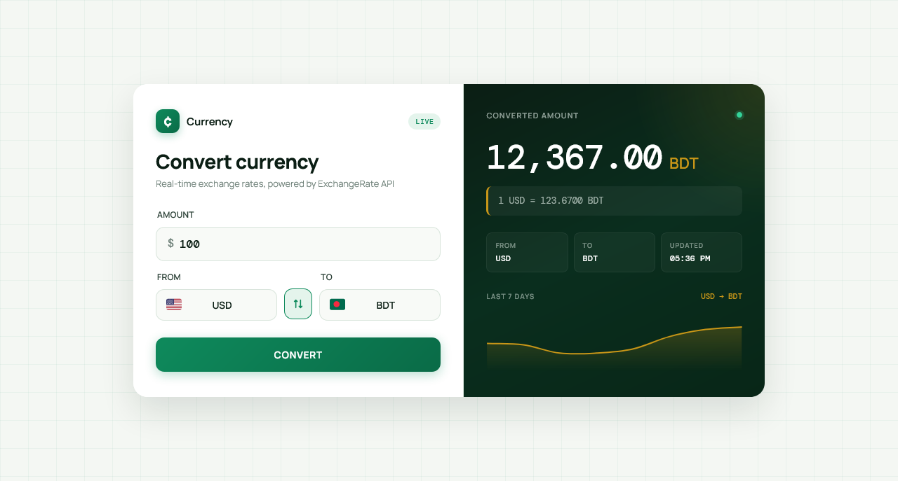

  

<h1 align="center">Currency Converter</h1>

  A sleek, fully responsive currency converter built with vanilla JavaScript — featuring real-time rates, live conversion, 7-day historical charts, and a modern emerald fintech aesthetic.

  
  

> Built while learning JavaScript.

---

## ✨ Features

- **Real-time exchange rates** — powered by ExchangeRate-API (no key required)
- **160+ currencies supported** — full list populated on load
- **Country flags** — matching emoji flag next to each currency code
- **Currency symbols** — auto-detected prefix (₹, ৳, $, €, ¥, ₩...) in the amount input
- **Live conversion** — type amount and rate updates automatically (400ms debounce)
- **Swap button** — rotate animation swaps From/To instantly
- **7-day historical chart** — golden line chart with gradient fill (via Frankfurter API)
- **Interactive tooltip** — hover chart to see daily rates
- **5-minute cache** — prevents redundant API calls
- **Smart defaults** — USD → BDT pre-selected (Bangladesh-friendly)
- **Same-currency handling** — gracefully detects `USD → USD` without API call
- **Rate display** — shows `1 USD = 83.45 BDT` below the result
- **Meta panel** — From / To / Last Updated info
- **Flash animation** — result number glows on update
- **Toast notifications** — success/error feedback (no `alert()`)
- **Split-panel layout** — form left, result right (stacks on mobile)
- **Fully responsive** — perfect on mobile (320px+), tablet, and desktop
- **Premium typography** — Manrope (UI) + DM Mono (numbers)

---

### 🔄 Dual API Strategy

| API | Purpose | Why |
|-----|---------|-----|
| **ExchangeRate-API** | Latest rates for conversion | Free, no key, 160+ currencies |
| **Frankfurter API** | 7-day historical series | Free, no key, time-series support |

The latest rates stay accurate (ExchangeRate-API), while historical charts get reliable data from a dedicated time-series source.

---

## 📊 Historical Chart

- **7-day line chart** — shows rate trend for selected pair
- **Golden line** with gradient fill — matches emerald theme
- **Auto-scaled Y-axis** — data range + 0.2% padding
- **Smooth curve** — tension 0.35
- **Tooltip** — shows exact rate on hover
- **Loading state** — "Loading chart..." while fetching
- **Graceful fallback** — if Frankfurter doesn't support the pair, chart silently hides

---

## 🌍 Supported Currencies

**Top ~50 with flags:** USD, EUR, GBP, JPY, CNY, AUD, CAD, CHF, HKD, SGD, INR, BDT, PKR, LKR, NPR, KRW, MYR, THB, IDR, PHP, VND, TRY, RUB, BRL, MXN, ZAR, AED, SAR, QAR, KWD, EGP, NGN, KES, ILS, NZD, SEK, NOK, DKK, PLN, CZK, HUF, RON, BGN, ISK, MAD

**Note:** Chart uses Frankfurter API which supports ~30 currencies. If a pair isn't supported, the chart hides automatically while conversion still works.

---

## 🐛 Robustness

- **Cache (5 min)** — repeated conversions don't hit the API
- **Debounce (400ms)** — typing doesn't spam the API
- **Same-currency check** — skips API call for `USD → USD`
- **NaN validation** — catches invalid amount input
- **Rate availability** — checks `rates[to]` exists before using
- **Chart fallback** — hides silently if Frankfurter fails or pair unsupported
- **Error toasts** — API failures don't crash the UI
- **Flag fallback** — "🌎" for unknown currencies

---

## 🔮 Future Ideas

- [ ] **Rate alerts** — notify when a pair hits a target
- [ ] **Currency favorites** — pin frequently used pairs
- [ ] **30-day chart** toggle (Frankfurter supports longer ranges)
- [ ] **Historical date picker** — convert using rates from any date
- [ ] **Offline mode** — PWA with cached rates
- [ ] **Dark mode** toggle
- [ ] **Multi-convert** — one amount → several currencies at once

---

## 🤝 Contributing

Contributions, issues, and feature requests are welcome!  
Feel free to check the [issues page](https://github.com/abdurrahman101bd/JavaScript/issues).

---

  Made with ❤️ while learning JavaScript

