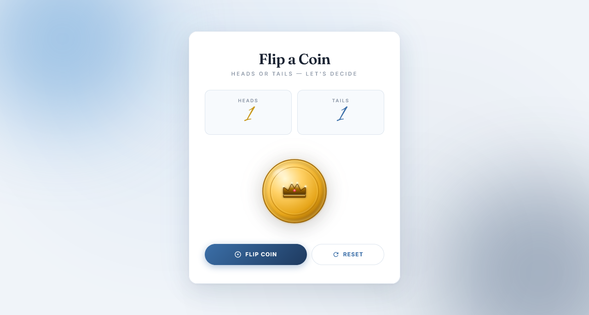

  

<h1 align="center">Flip a Coin</h1>

  A sleek, fully responsive coin flip simulator built with vanilla JavaScript — featuring a realistic 3D coin animation, live statistics, and a coastal editorial aesthetic.

  
  

> Built while learning JavaScript.

---

## ✨ Features

- **Realistic 3D coin flip** — smooth `rotateX` spin animation powered by CSS keyframes
- **Random outcome** — 50/50 chance between heads and tails using `Math.random()`
- **Live statistics** — heads & tails counts update automatically after every flip
- **Animated count bump** — Alex Brush score numbers scale up with a smooth bounce
- **Color-coded stats** — gold for heads, blue for tails
- **Custom SVG coins** — golden crown for heads, cyan-blue 8-point star for tails (fully scalable)
- **Pulsing coin glow** — soft warm gold ambient glow beneath the coin
- **Shine sweep on button** — light sweeps across the flip button on hover
- **Disabled state** — flip button locks during the 3-second animation
- **Reset option** — pill-shaped ghost button to clear the stats
- **Coastal editorial aesthetic** — cool blue palette with off-white background
- **Glow orbs in background** — sky blue top-left + deep navy bottom-right
- **Elegant typography** — Fraunces serif titles + Alex Brush score numbers + Inter body
- **Fully responsive** — perfect on mobile (320px+), tablet, and desktop
- **Premium fonts** — Fraunces + Alex Brush + Inter

---

## 🐛 Robustness

- **Re-trigger animation** — clearing `animation` + forced reflow ensures a clean spin every time
- **Button lock** — flip button disables for 3s to prevent spam
- **Bump animations** — score numbers bounce on every update
- **Reset** — clears both counters with bump feedback
- **SVG coins** — crisp at any size, no external images to load
- **Responsive sizes** — `clamp()` keeps the coin readable on all screens
- **Reset animation state** — reset clears the coin's animation to avoid desync

---

## 🔮 Future Ideas

- [ ] **Coin flip sound** — metal clang via Web Audio API
- [ ] **Streak counter** — track consecutive heads/tails
- [ ] **History chart** — visualize last 10 flips
- [ ] **Achievements** — "5 heads in a row!" badges
- [ ] **Coin shine sweep** — light moving across while spinning
- [ ] **Prediction mode** — guess before the flip
- [ ] **Multi-coin flip** — flip 2–3 coins at once
- [ ] **Dark / light theme** toggle

---

## 🤝 Contributing

Contributions, issues, and feature requests are welcome!  
Feel free to check the [issues page](https://github.com/abdurrahman101bd/JavaScript/issues).

---

  Made with ❤️ while learning JavaScript

