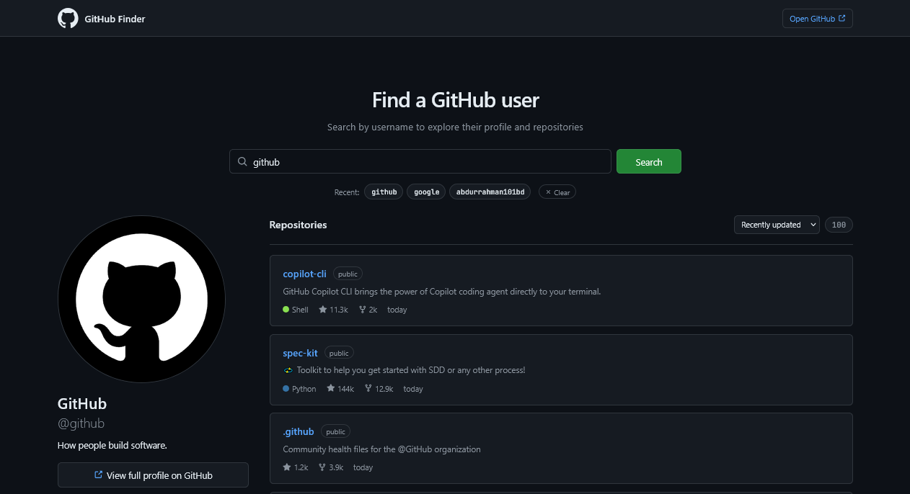

  

<h1 align="center">GitHub User Finder</h1>

  A sleek, fully responsive GitHub profile explorer built with vanilla JavaScript — featuring a GitHub-native dark theme, recent search history, repo sorting, and pagination.

  
  

> Built while learning JavaScript.

---

## ✨ Features

- **Search any GitHub user** — via the official GitHub REST API
- **GitHub-native dark theme** — matches GitHub's actual design language (Primer palette)
- **Full profile view** — avatar, name, username, bio, company, location, website, join date
- **Live stats** — followers, following, public repos (compact number formatting like `1.2k`, `10k`)
- **View full profile on GitHub** — one-click link to the real profile
- **Repository explorer** — up to 100 repos fetched, 6 shown at a time
- **"Show more" pagination** — load additional repos on demand
- **Repo sorting** — Recently updated / Most starred / Name (A-Z)
- **Language color dots** — real GitHub language colors (JavaScript, Python, Rust, Go, etc.)
- **Relative timestamps** — "today", "2 days ago", "3 months ago"
- **Repo metadata** — stars, forks, visibility badge, description, updated time
- **Recent searches** — last 4 usernames saved in localStorage
- **Individual chip removal** — hover a chip to reveal an × icon; click to remove just that one
- **Clear all recent** — bulk clear button with toast feedback
- **Skeleton loading** — shimmer placeholders while fetching repos
- **Loading spinner** — in the search button during fetch
- **Smart error handling** — distinct messages for 404 (not found) vs 403 (rate limit)
- **Conditional display** — empty bio/company/location/blog hide gracefully
- **Empty & initial states** — helpful prompts before search
- **Fully responsive** — perfect on mobile (320px+), tablet, and desktop
- **Toast notifications** — success/error feedback
- **System font stack** — GitHub's actual typography

---

### 🧠 API Endpoints

| Endpoint | Purpose |
|----------|---------|
| `GET /users/{username}` | Profile data |
| `GET /users/{username}/repos?per_page=100&sort=updated` | All public repos |

**Rate limit:** 60 requests/hour unauthenticated. The app shows a distinct error message when this limit is hit.

---

## 🎨 Design Highlights

| Element | Style |
|---------|-------|
| **Background** | GitHub dark `#0d1117` |
| **Cards** | `#161b22` with `#30363d` borders |
| **Text** | `#e6edf3` (primary), `#8b949e` (muted) |
| **Accent** | GitHub blue `#58a6ff` |
| **Success** | GitHub green `#238636` |
| **Danger** | GitHub red `#f85149` |
| **Font** | GitHub's system font stack |
| **Mono** | JetBrains Mono for numbers |
| **Header** | Sticky GitHub-style top bar |
| **Layout** | Two-column (296px sidebar + fluid) |
| **Borders** | 1px `#30363d` — GitHub signature |

---

## 📱 Responsive Breakpoints

| Breakpoint | Layout |
|------------|--------|
| `≤ 480px` | Compact fonts, tighter spacing |
| `≤ 768px` | Single-column, sticky header removed, profile centered |
| `≥ 900px` | Full two-column desktop layout |

---

## 🏷️ Recent Searches

- **Stored in localStorage** under `gh_finder_recent`
- **Max 4 items** — oldest auto-removed on new search
- **Duplicates avoided** — same user moves to front
- **Individual removal** — hover a chip → × icon appears
- **Clear all** — "✕ Clear" button on the right
- **Chip click** → re-search that user

---

## 🐛 Robustness

- **`[hidden] { display: none !important; }`** — critical rule to prevent CSS `display` from overriding `hidden` attribute
- **Distinct error states** — 404 (not found) vs 403 (rate limit) vs generic
- **Conditional rendering** — bio/company/blog/location containers hide when empty
- **Safe HTML escaping** — prevents XSS in repo descriptions
- **Loading guards** — button disables during fetch, skeleton for repos
- **Skeleton states** — no layout shift while loading
- **Rate limit awareness** — helpful error message when API throttles

---

## 🔮 Future Ideas

- [ ] **Dark / light mode** toggle
- [ ] **Contribution graph** embed
- [ ] **Top languages** mini chart
- [ ] **Star history** sparkline
- [ ] **Organization search** support
- [ ] **GitHub token support** — bypass rate limit
- [ ] **Compare users** — side-by-side view
- [ ] **Share profile card** — export as image

---

## 🤝 Contributing

Contributions, issues, and feature requests are welcome!  
Feel free to check the [issues page](https://github.com/abdurrahman101bd/JavaScript/issues).

---

  Made with ❤️ while learning JavaScript

