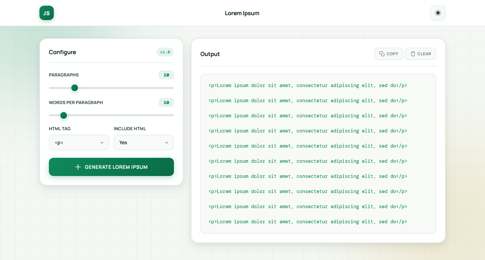

<p align="center">
  
</p>

<h1 align="center">Lorem Ipsum Generator</h1>

<p align="center">
  A sleek, fully responsive Lorem Ipsum generator built with vanilla HTML, CSS & JavaScript — featuring a split-panel layout, dark/light mode, and a warm emerald aesthetic.
</p>

<p align="center">
  <a href="https://abdurrahman101bd.github.io/JavaScript/lorem-ipsum-generator">
    
  </a>
  
</p>

> Built while learning JavaScript.

---

## ✨ Features

- **Dark / Light mode** — theme toggle with `localStorage` persistence
- **Split-panel layout** — configure on the left, output on the right
- **Custom range sliders** — choose 1–50 paragraphs and 1–100 words per paragraph
- **Tag wrapping** — wrap output in `<p>`, `<h1>`–`<h6>`, or `<span>`
- **XSS-safe output** — tags are shown as plain text using `textContent`, never `innerHTML`
- **Copy & Clear buttons** — copy the generated text (with or without tags) in one click
- **Scrollable output box** — fixed max-height keeps the layout clean
- **Empty state** — helpful prompt shown before any text is generated
- **Responsive design** — fully optimized for mobile and desktop
- **Warm emerald aesthetic** — cream background with soft glow orbs
- **Subtle grid background** — faint green blueprint lines
- **Premium typography** — Manrope + DM Mono

---

## 🎨 Design Highlights

| Element | Style |
|---------|-------|
| **Background** | Warm off-white `#f4f7f3` with subtle green grid |
| **Glow orbs** | Emerald `#0e8a5c` + gold `#c89618` (soft) |
| **Navigation** | Sticky header with logo + theme toggle |
| **Layout** | Split-panel — options left, output right |
| **Cards** | Pure white with rounded 20px corners + warm shadow |
| **Slider thumbs** | Emerald gradient with white border |
| **Selects** | Cream with emerald focus glow |
| **Generate button** | Emerald gradient with shine sweep |
| **Output** | Cream panel with DM Mono text |
| **Copy button** | Cream with emerald hover + success state |
| **Empty state** | Document icon + prompt |

---

## 🎨 Theme System

Two themes included:

| Theme | Background | Surface | Accent |
|-------|-----------|---------|--------|
| **Light** | `#f4f7f3` | `#ffffff` | Emerald `#0e8a5c` |
| **Dark** | `#0a1410` | `#111f1a` | Emerald `#0e8a5c` (brighter) |

Theme preference is saved in `localStorage` and restored on page load. Uses `body.darkmode` class for CSS variable overrides.

---

## 🛠️ Tech Stack

| Technology | Usage |
|------------|-------|
| **HTML5** | Structure & semantic markup |
| **CSS3** | Grid layout, gradients, animations, responsive design (`clamp()`) |
| **JavaScript (Vanilla)** | Lorem generation, DOM updates, localStorage |
| **Clipboard API** | Copy with fallback |
| **Google Fonts** | Manrope, DM Mono |

---

### 🎨 HTML Tag Wrapping

When **"Include HTML"** is set to **Yes**, each paragraph is wrapped in the chosen tag:

```html
<p>Lorem ipsum dolor sit amet...</p>
<p>Consectetur adipiscing elit...</p>
```

When set to **No**, raw text is output without tags.

---

## ⌨️ Keyboard & Interaction

| Action | Result |
|--------|--------|
| **Slide paragraph slider** | Live count updates |
| **Slide words slider** | Live count updates |
| **Click Generate** | Text appears in output |
| **Click Copy** | Text copied + button morphs to "Copied!" |
| **Click Clear** | Output cleared, empty state shown |
| **Click theme toggle** | Light ↔ dark mode |

---

## 🐛 Robustness

- **XSS-safe rendering** — tags shown as plain text via `textContent`, not `innerHTML`
- **localStorage safety** — theme preference persists across sessions
- **Copy fallback** — falls back to `execCommand` if Clipboard API fails
- **Empty input guard** — Copy does nothing if output is empty
- **Slider bounds** — min/max enforced by `input[type="range"]`
- **Allowed tags whitelist** — only `p`, `h1`–`h6`, `span` permitted
- **Buffer for long text** — LOREM_WORDS extends by concatenation if user requests more words

---

## 🔮 Future Ideas

- [ ] **Sentences per paragraph** — alternative granularity
- [ ] **Classic "Lorem" vs. random words** — toggle generation mode
- [ ] **HTML preview mode** — render the output as HTML
- [ ] **Download as .txt** — save the output to file
- [ ] **Word counter** — show total output length
- [ ] **Custom word list** — paste your own source words
- [ ] **Sentence case / title case** — formatting options
- [ ] **History** — last 5 generated outputs

---

## 🤝 Contributing

Contributions, issues, and feature requests are welcome!  
Feel free to check the [issues page](https://github.com/abdurrahman101bd/JavaScript/issues).

---

<p align="center">
  Made with ❤️ while learning JavaScript
</p>