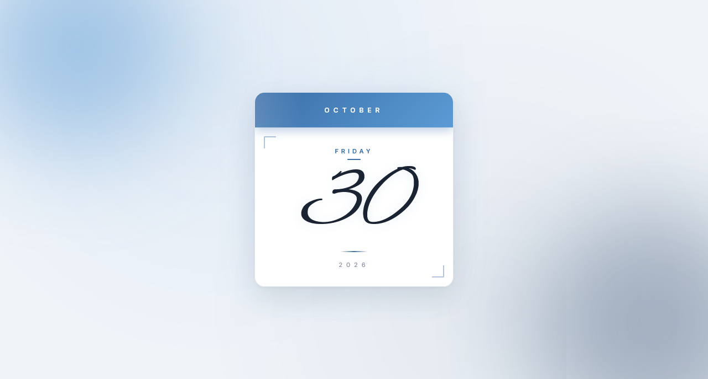

  

<h1 align="center">Mini Calendar</h1>

  A sleek, fully responsive mini calendar built with vanilla JavaScript — featuring a coastal editorial aesthetic, elegant script typography, and subtle blue glow accents.

  
  

> Built while learning JavaScript.

---

## ✨ Features

- **Live date display** — automatically shows today's month, day, date, and year
- **Coastal editorial aesthetic** — cool blue palette with soft off-white background
- **Glow orbs in background** — sky blue top-left + deep navy bottom-right, both animated
- **Blue gradient month header** — smooth transition with animated shine sweep
- **Alex Brush script day number** — elegant calligraphy for the hero number
- **Pulse glow animation** — soft blue breathing on the day number
- **Decorative corner brackets** — subtle editorial framing around the body
- **Underlined day name** — accent detail with gradient divider
- **Warm cool shadow** — multi-layer blue-tinted shadow under the card
- **Smooth entry animation** — card slides in with scale on load
- **Hover lift** — card lifts gracefully with a blue glow bloom on desktop
- **Fully responsive** — perfect on mobile (320px+), tablet, and desktop
- **Premium typography** — Inter + Playfair Display + Alex Brush fonts

---

## 🔮 Future Ideas

- [ ] **Month navigation** — browse previous/next months
- [ ] **Full mini month grid** — small calendar with all days
- [ ] **Special date highlighting** — birthdays, holidays
- [ ] **Dark mode toggle** — inverted blue theme
- [ ] **Multiple themes** — switch palettes on the fly
- [ ] **Bengali / multi-language** support
- [ ] **Drag-to-resize** card

---

## 🤝 Contributing

Contributions, issues, and feature requests are welcome!  
Feel free to check the [issues page](https://github.com/abdurrahman101bd/JavaScript/issues).

---

  Made with ❤️ while learning JavaScript

