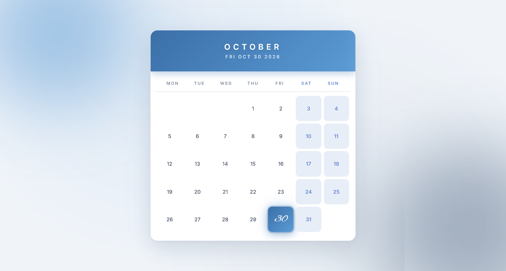

<p align="center">
  
</p>

<h1 align="center">Month Calendar</h1>

<p align="center">
  A sleek, fully responsive month calendar built with vanilla JavaScript — featuring a coastal editorial aesthetic, elegant script typography, and live blue theme rendering.
</p>

<p align="center">
  <a href="https://abdurrahman101bd.github.io/JavaScript/month-calendar">
    
  </a>
  
</p>

> Built while learning JavaScript.

---

## ✨ Features

- **Live month view** — automatically renders the current month with the correct number of days
- **Today highlighted** — today's date shown with blue gradient + elegant Alex Brush script
- **Pulse glow animation** — soft blue breathing on the today's number
- **Monday-first layout** — week starts on Monday (ISO standard)
- **Weekend highlight** — Saturday & Sunday shown with soft blue tint
- **Coastal editorial aesthetic** — cool blue palette with off-white background
- **Glow orbs in background** — sky blue top-left + deep navy bottom-right, both animated
- **Blue gradient month header** — smooth transition with animated shine sweep
- **Divider under weekdays** — subtle editorial detail between header and grid
- **Staggered entry animation** — each day fades in with a small delay
- **Hover effects** — days lift with a blue tint and shadow (desktop only)
- **Fully responsive** — perfect on mobile (320px+), tablet, and desktop
- **Premium typography** — Inter + Alex Brush fonts
- **CSS Grid layout** — perfect square cells at any screen size

---

### 🧠 Grid Logic

```js
// 1. Get current month info
const lastDay = new Date(year, monthInx + 1, 0).getDate();

// 2. Fix Monday-first index (Sunday = 0 → 6)
const rawFirst = new Date(year, monthInx, 1).getDay();
const firstDay = rawFirst === 0 ? 6 : rawFirst - 1;

// 3. Build padding + real days
```

- **Padding cells** — empty divs before the 1st
- **Weekend detection** — `(firstDay + i - 1) % 7`, index 5 & 6 = Sat & Sun
- **Today check** — `i === today.getDate()`

---

## 🐛 Robustness

- **Monday-first logic** — handles Sunday edge case (index 0 → 6)
- **Today detection** — correct even on the 1st of the month
- **Weekend highlighting** — independent of today
- **Stagger animation** — inline `animation-delay` per day
- **No external calendar library** — pure vanilla JS
- **Sticky weekend tints** — don't interfere with today highlight

---

## 🔮 Future Ideas

- [ ] **Prev / Next month** navigation
- [ ] **Click to select** a date (with detail view)
- [ ] **Month-specific color palettes** (Jan = blue, Feb = pink...)
- [ ] **Special day markers** (birthdays, holidays)
- [ ] **Dark mode toggle** — inverted blue theme
- [ ] **Event notes** — click a day to add a note
- [ ] **Bengali / multi-language** support

---

## 🤝 Contributing

Contributions, issues, and feature requests are welcome!  
Feel free to check the [issues page](https://github.com/abdurrahman101bd/JavaScript/issues).

---

<p align="center">
  Made with ❤️ while learning JavaScript
</p>