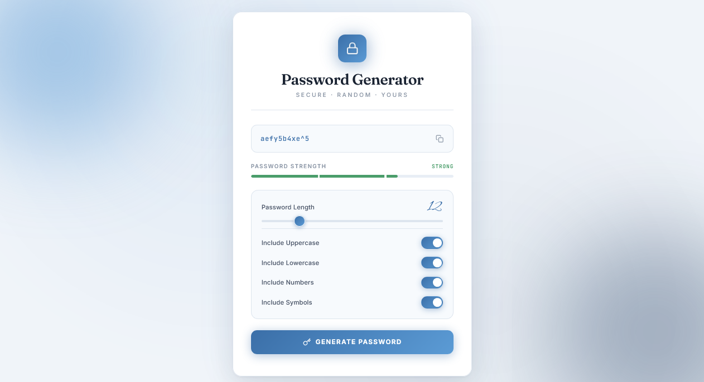

<p align="center">
  
</p>

<h1 align="center">Password Generator</h1>

<p align="center">
  A sleek, fully responsive password generator built with vanilla JavaScript — featuring cryptographically secure randomness, live strength meter, and a coastal editorial aesthetic.
</p>

<p align="center">
  <a href="https://abdurrahman101bd.github.io/JavaScript/password-generator">
    
  </a>
  
</p>

> Built while learning JavaScript.

---

## ✨ Features

- **Cryptographically secure passwords** — uses `crypto.getRandomValues()` instead of `Math.random()` for real security
- **Adjustable length** — 6 to 32 characters via animated slider
- **4 character type toggles** — uppercase, lowercase, numbers, symbols
- **Live strength meter** — 3-tier visual feedback (Weak / Medium / Strong) with color + bar width
- **Dynamic strength calculation** — scores based on length + character variety
- **Character type validation** — shows error toast if no types are selected
- **One-click copy** — with clipboard API + `execCommand` fallback for mobile
- **Animated copy feedback** — icon morphs from copy → check with color transition
- **Auto-generate on load** — first password appears instantly
- **Coastal editorial aesthetic** — cool blue palette with off-white background
- **Glow orbs in background** — sky blue top-left + deep navy bottom-right, both animated
- **Editorial serif headings** — Fraunces serif + Alex Brush script accents
- **Corner brackets** — subtle editorial framing detail
- **Custom slider** — blue gradient thumb with white border + hover scale
- **Animated toggles** — smooth slide with blue gradient when on
- **Bump animation** — Alex Brush script length number pulses on change
- **Toast notifications** — smooth slide-in with success/error variants
- **Paper card** — white with blue-tinted shadows
- **Fully responsive** — perfect on mobile (320px+), tablet, and desktop
- **Premium typography** — Fraunces + Inter + Alex Brush + JetBrains Mono

---

### 🔐 Secure Randomness

```js
function secureRandom(max) {
  if (window.crypto && window.crypto.getRandomValues) {
    const arr = new Uint32Array(1);
    window.crypto.getRandomValues(arr);
    return arr[0] % max;
  }
  return Math.floor(Math.random() * max);
}
```

`Math.random()` is **predictable** and should **never** be used for passwords. `crypto.getRandomValues()` taps into the OS's entropy pool — the same source used by browsers and password managers.

### 📊 Strength Calculation

| Factor | Weight |
|--------|--------|
| **Length** | `min(length × 2.5, 40)` points |
| **Has uppercase** | +15 points |
| **Has lowercase** | +15 points |
| **Has numbers** | +15 points |
| **Has symbols** | +15 points |

| Score | Label | Color |
|-------|-------|-------|
| < 40 | **Weak** | Soft red `#d96a6a` |
| 40–69 | **Medium** | Warm amber `#d4a04a` |
| ≥ 70 | **Strong** | Sage green `#4a9d6a` |

Passwords under 8 characters are capped at **Weak** regardless of variety.

---

## 🐛 Robustness

- **Secure randomness** — `crypto.getRandomValues()` with `Math.random()` fallback
- **Validation** — at least one character type required
- **Clipboard fallback** — `execCommand` for older browsers and non-HTTPS contexts
- **Length calculation** — `padStart` keeps numbers formatted
- **No external dependencies** — pure vanilla JS
- **Debounced interactions** — toast timers prevent spam

---

## 🔮 Future Ideas

- [ ] **Exclude similar characters** — remove `0/O`, `1/l/I`
- [ ] **Memorable password mode** — diceware-style word-based passwords
- [ ] **Passphrase generator** — 3–4 random words
- [ ] **History** — last 5 generated passwords (session only)
- [ ] **Export as file** — download password to `.txt`
- [ ] **QR code** — scan to transfer to phone
- [ ] **Dark / light theme toggle**

---

## ⚠️ Note

> This is a demo project. For production use, consider established tools like **1Password** or **Bitwarden** — but the cryptography principles here are sound.

---

## 🤝 Contributing

Contributions, issues, and feature requests are welcome!  
Feel free to check the [issues page](https://github.com/abdurrahman101bd/JavaScript/issues).

---

<p align="center">
  Made with ❤️ while learning JavaScript
</p>