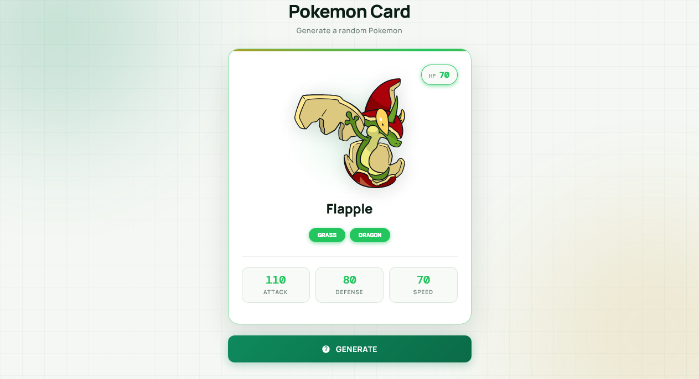

  

<h1 align="center">Pokemon Card Generator</h1>

  A sleek, fully responsive Pokemon card generator built with vanilla JavaScript — featuring type-based theming, animated card reveal, image fallback handling, and a warm emerald aesthetic.

  
  

> Built while learning JavaScript.

---

## ✨ Features

- **Random Pokemon on demand** — fetches any of 898 Pokemon from PokeAPI
- **Type-based theming** — card top accent, HP badge, glow, buttons, and stats adopt the Pokemon's primary type color
- **All 18 types mapped** — bug, dark, dragon, electric, fairy, fighting, fire, flying, ghost, grass, ground, ice, normal, poison, psychic, rock, steel, water
- **Smart image fallback** — tries dream_world → official artwork → home → default sprite
- **Inline error fallback** — worst case uses the default sprite so a broken image never appears
- **Animated card reveal** — image pops in with a bouncy scale animation
- **Glow halo behind image** — soft pulsing radial glow in the Pokemon's type color
- **HP badge** — cream pill with type-colored border and value
- **Type badges** — pill-shaped tags with per-type colors and glow
- **Interactive stats** — attack, defense, speed cream cards with hover lift + type-colored glow
- **Loading state** — emerald spinner while fetching
- **Error state** — user-friendly message if the fetch fails
- **Auto-generate on load** — first Pokemon appears instantly on page open
- **Warm emerald aesthetic** — cream background with soft glow orbs
- **Fully responsive** — perfect on mobile (320px+), tablet, and desktop
- **Premium typography** — Manrope + DM Mono

---

## 🐛 Robustness

- **Broken image fix** — `dream_world.front_default` is often `null`; now falls back through 4 sources
- **Complete type map** — all 18 type colors and glows defined
- **Error handling** — fetch failures show a friendly sad emoji placeholder
- **Loading state** — emerald spinner while fetching
- **Async/await** — clean promise handling with try/catch/finally
- **898 Pokemon** — expanded from 150 to include Gen 1–8
- **Double-click guard** — `isLoading` flag prevents overlapping fetches
- **CSS variables** — theming via `--card-color` and `--card-glow` (no inline styles)

---

## 🔮 Future Ideas

- [ ] **Search by name** — generate a specific Pokemon
- [ ] **Flip animation** — card flip to reveal back stats
- [ ] **Favorite Pokemon** — save favorites with localStorage
- [ ] **Stat bars** — visual progress bars per stat
- [ ] **Cry sound** — play the Pokemon's cry via PokeAPI
- [ ] **Shiny variant** — 50% chance of shiny sprite
- [ ] **Evolution chain** — show evolutions
- [ ] **Type filter** — pick a Pokemon of a specific type

---

## 🤝 Contributing

Contributions, issues, and feature requests are welcome!  
Feel free to check the [issues page](https://github.com/abdurrahman101bd/JavaScript/issues).

---

  Made with ❤️ while learning JavaScript

