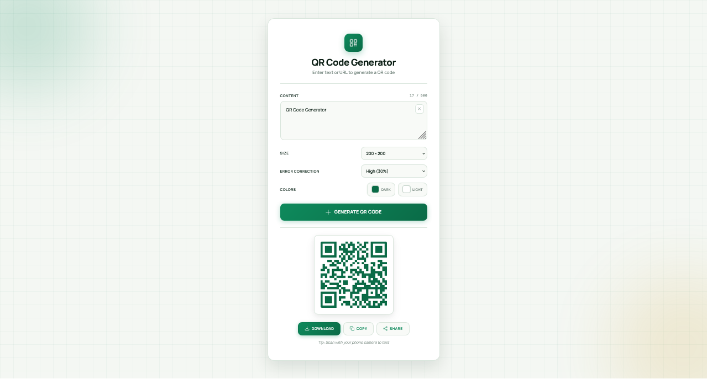

  

<h1 align="center">QR Code Generator</h1>

  A sleek, fully responsive QR code generator built with vanilla JavaScript — featuring live color customization, error correction levels, clipboard copy, and a warm emerald aesthetic.

  
  

> Built while learning JavaScript.

---

## ✨ Features

- **Generate QR codes instantly** — from any text or URL
- **5 size options** — 150 × 150 to 500 × 500 px
- **4 error correction levels** — Low (7%), Medium (15%), Quartile (25%), High (30%)
- **Custom colors** — pick dark and light colors via native color picker
- **Live regeneration** — QR updates automatically when you change size, EC level, or colors
- **Ctrl/Cmd + Enter shortcut** — generate without clicking the button
- **Character counter** — shows length, warns when > 400/500 chars
- **Clear button** — appears when text is entered, clears input + QR
- **Download as PNG** — saves with timestamp filename
- **Copy to clipboard** — copies QR image (not text) for pasting anywhere
- **Native share** — Web Share API on mobile (share image directly)
- **Loading spinner** — visual feedback while generating
- **Toast notifications** — success/error feedback (no more `alert()`)
- **Scan tip** — helpful hint below the QR
- **Warm emerald aesthetic** — cream background with soft glow orbs
- **Subtle grid background** — faint green blueprint lines
- **Fully responsive** — perfect on mobile (320px+), tablet, and desktop
- **Premium typography** — Manrope + DM Mono

---

## 🎨 Design Highlights

| Element | Style |
|---------|-------|
| **Background** | Warm off-white `#f4f7f3` with subtle green grid |
| **Glow orbs** | Emerald `#0e8a5c` + gold `#c89618` (soft) |
| **Card** | Pure white with rounded 20px corners + warm shadow |
| **Header icon** | Emerald gradient rounded square |
| **Heading** | Manrope extra-bold |
| **Textarea** | Cream bg with emerald focus glow |
| **Selects** | Cream with emerald focus |
| **Color pickers** | Cream with emerald hover |
| **Generate button** | Emerald gradient with shine sweep |
| **QR container** | White with soft warm shadow |
| **Action buttons** | Cream with emerald hover |
| **Toast** | Ink dark pill |

---

## 🎨 Error Correction Levels

| Level | Recovery | Use Case |
|-------|----------|----------|
| **L** | 7% | Clean environments |
| **M** | 15% | Standard usage |
| **Q** | 25% | Moderate damage |
| **H** | 30% | **Recommended** — most resilient |

Higher EC levels produce denser QR codes but are more reliable when printed, scanned at angles, or partly damaged.

---

## 🛠️ Tech Stack

| Technology | Usage |
|------------|-------|
| **HTML5** | Structure & semantic markup |
| **CSS3** | Grid layout, gradients, responsive design (`clamp()`) |
| **JavaScript (Vanilla)** | QR generation logic, DOM updates |
| **QRCode.js** | QR generation library (via CDN) |
| **Clipboard API** | Copy image to clipboard |
| **Web Share API** | Native mobile share |
| **Google Fonts** | Manrope, DM Mono |

---

## ⌨️ Keyboard & Interactions

| Action | Result |
|--------|--------|
| **Click Generate** | Generate QR from current input |
| **Ctrl/Cmd + Enter** | Generate (from anywhere in textarea) |
| **Change size** | Auto-regenerate if QR exists |
| **Change EC level** | Auto-regenerate |
| **Change colors** | Auto-regenerate |
| **Click X (clear)** | Clears input + hides QR |

---

## 🐛 Robustness

- **Library loading check** — shows error if QRCode.js hasn't loaded
- **Empty input guard** — toast if user tries to generate with no text
- **Canvas availability** — checks for canvas before extracting data URL
- **Clipboard fallback** — graceful error if image clipboard unsupported
- **Share fallback** — graceful error if Web Share API unavailable
- **Abort-safe share** — user cancels share → no error thrown
- **Async-safe generation** — `isGenerating` flag prevents double-clicks
- **Clean re-render** — QR container cleared before each generation

---

## 🔮 Future Ideas

- [ ] **Logo overlay** — embed a small logo in the QR center
- [ ] **Batch generation** — CSV upload → multiple QR codes
- [ ] **Style presets** — dots, rounded corners, gradient modules
- [ ] **URL shortener integration** — shorten before generating
- [ ] **History** — save last N generated QRs
- [ ] **SVG export** — download as vector instead of PNG
- [ ] **Wi-Fi QR** — special format for network sharing
- [ ] **vCard QR** — generate contact cards

---

## 🤝 Contributing

Contributions, issues, and feature requests are welcome!  
Feel free to check the [issues page](https://github.com/abdurrahman101bd/JavaScript/issues).

---

  Made with ❤️ while learning JavaScript

