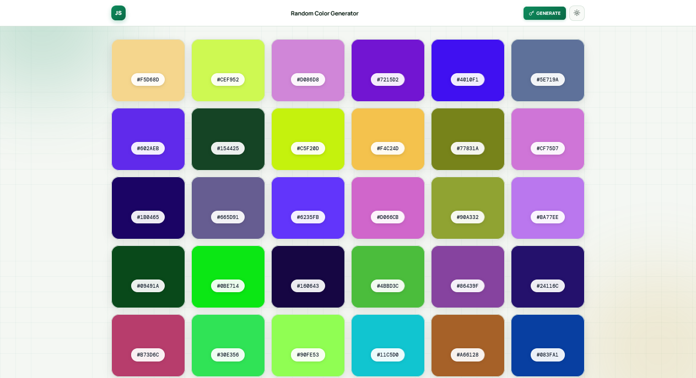

<p align="center">
  
</p>

<h1 align="center">Random Color Generator</h1>

<p align="center">
  A sleek, fully responsive color palette generator built with vanilla JavaScript — featuring one-click hex generation, instant copy, dark mode, and a warm emerald aesthetic.
</p>

<p align="center">
  <a href="https://abdurrahman101bd.github.io/JavaScript/random-color-generator">
    
  </a>
  
</p>

> Built while learning JavaScript.

---

## ✨ Features

- **One-click Generate** — refresh all 30 color cards instantly
- **Click to Copy** — tap any color card to copy its hex code to clipboard
- **Animated Toast** — color swatch preview + progress bar + auto-dismiss
- **Dark / Light mode** — theme toggle with `localStorage` persistence
- **Frosted glass hex pills** — DM Mono hex codes on translucent pills
- **Copy hint on hover** — subtle prompt appears when hovering a card
- **Smooth card lift** — cards lift + deepen shadow on hover
- **Staggered entry** — cards fade in with a small per-index delay
- **Auto-fill grid** — responsive layout with `minmax(180px, 1fr)`
- **Fully responsive** — perfect on mobile (320px+), tablet, and desktop
- **Warm emerald aesthetic** — cream background with soft glow orbs
- **Subtle grid background** — faint green blueprint lines
- **Premium typography** — Manrope + DM Mono
- **Zero dependencies** — pure vanilla JavaScript

---

## 🎨 Design Highlights

| Element | Style |
|---------|-------|
| **Background** | Warm off-white `#f4f7f3` with subtle green grid |
| **Glow orbs** | Emerald `#0e8a5c` + gold `#c89618` (soft) |
| **Navigation** | Sticky header with logo + Generate + theme toggle |
| **Color cards** | 20px rounded with warm shadow + hover lift |
| **Hex pill** | Frosted glass `rgba(255,255,255,0.92)` with fixed dark text |
| **Generate button** | Emerald gradient with icon rotation |
| **Copy hint** | Slides up + fades in on hover |
| **Toast** | Ink dark with color swatch + progress bar |
| **Dark mode** | Full inverted emerald palette |

---

## 🎨 Theme System

Two themes included:

| Theme | Background | Surface | Accent |
|-------|-----------|---------|--------|
| **Light** | `#f4f7f3` | `#ffffff` | Emerald `#0e8a5c` |
| **Dark** | `#0a1410` | `#111f1a` | Emerald `#0e8a5c` (brighter) |

Theme preference is saved in `localStorage` and restored on page load. Uses `body.darkmode` class for CSS variable overrides. Hex pill keeps its fixed dark text so codes remain readable in both themes.

---

## 🛠️ Tech Stack

| Technology | Usage |
|------------|-------|
| **HTML5** | Structure & semantic markup |
| **CSS3** | Auto-fill grid, gradients, animations, responsive design (`clamp()`) |
| **JavaScript (Vanilla)** | Color generation, DOM updates, clipboard, localStorage |
| **Clipboard API** | Copy with fallback |
| **Google Fonts** | Manrope, DM Mono |

---

## 🎨 Color Generation

Each color is generated as a random 6-character hex code:

```js
function randomColor() {
  const chars = "0123456789abcdef";
  let code = "";
  for (let i = 0; i < 6; i++) {
    code += chars[Math.floor(Math.random() * chars.length)];
  }
  return code;
}
```

Produces any of **16,777,216 possible colors** (16⁶).

---

## 🐛 Robustness

- **Clipboard fallback** — falls back to `execCommand` for non-HTTPS contexts
- **Theme persistence** — saved in `localStorage`, restored on load
- **Copy timeout** — auto-dismiss toast after 1.6s
- **Fixed hex text color** — codes remain readable in both light and dark themes
- **Explicit fill on SVGs** — sun/moon icons render correctly
- **Bounded generation** — exactly 30 cards, always fully populated
- **Reload-safe** — theme preference survives refresh

---

## 🔮 Future Ideas

- [ ] **Card count selector** — 6 / 12 / 30 / 60 cards
- [ ] **Color format toggle** — HEX / RGB / HSL
- [ ] **Palette mode** — harmonious palettes instead of pure random
- [ ] **Copy all** — copy entire palette as CSS variables
- [ ] **Download palette** — export as PNG / JSON / CSS
- [ ] **Save favorites** — localStorage for bookmarked colors
- [ ] **Color blindness simulator** — preview filters
- [ ] **Gradient generator** — pick 2 colors → preview gradient

---

## 🤝 Contributing

Contributions, issues, and feature requests are welcome!  
Feel free to check the [issues page](https://github.com/abdurrahman101bd/JavaScript/issues).

---

<p align="center">
  Made with ❤️ while learning JavaScript
</p>