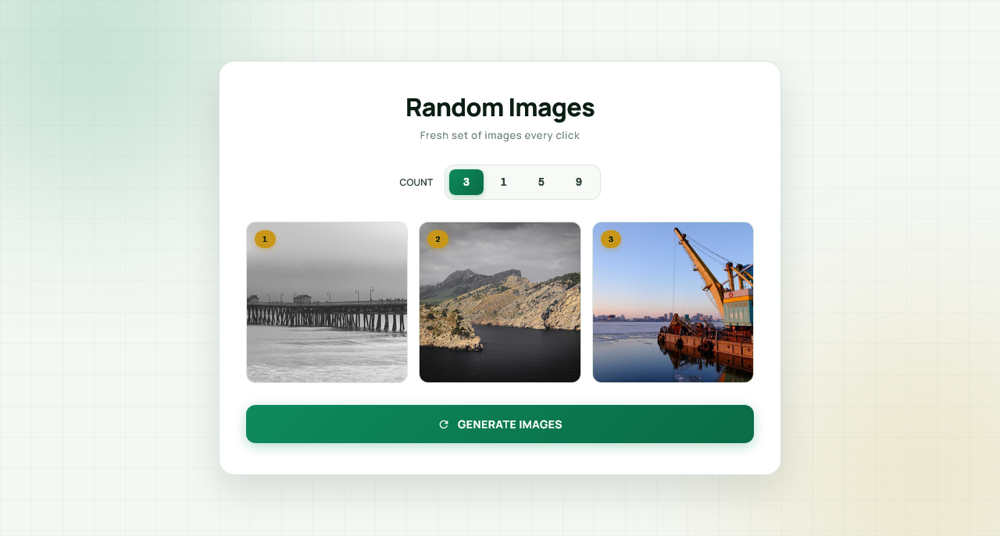

  

<h1 align="center">Random Images Generator</h1>

  A sleek, fully responsive random image generator built with vanilla JavaScript — featuring a count selector, shuffle animation, per-image download, lightbox preview, and a warm emerald aesthetic.

  
  

> Built while learning JavaScript.

---

## ✨ Features

- **Random images on demand** — fresh set fetched from Picsum on every click
- **Count selector** — choose 1, 3, 5, or 9 images at a time
- **Shuffle animation** — old cards scale out, new ones scale in smoothly
- **Per-image download** — hover a card to reveal a download button
- **Lightbox preview** — click any image to open it in a large overlay
- **Download from lightbox** — save the enlarged image directly
- **Skeleton loading** — shimmer placeholders while images fetch
- **Staggered fade-in** — each image appears with a small delay
- **Hover zoom** — cards lift and zoom gently with an emerald glow
- **Number badges** — gold pill labels (01, 02, 03...) on each card
- **Broken image fallback** — safe placeholder if an image fails to load
- **Keyboard shortcuts** — `Esc` closes the lightbox
- **Overlay click closes lightbox** — intuitive dismissal
- **Button loading state** — spinner prevents double-clicks during fetch
- **Emerald + gold aesthetic** — warm cream background with soft glow orbs
- **Fully responsive** — perfect on mobile (320px+), tablet, and desktop
- **Premium typography** — Manrope + DM Mono

---

## ⌨️ Keyboard & Interaction

| Action | Result |
|--------|--------|
| **Click image** | Open lightbox |
| **Click download (card)** | Save image |
| **Click download (lightbox)** | Save enlarged image |
| **Click overlay** | Close lightbox |
| **Press Esc** | Close lightbox |
| **Hover card** | Reveal download button + lift |

---

## 🐛 Robustness

- **Download reliability** — uses `fetch` + `Blob` for a real cross-origin download, with a `window.open` fallback
- **Broken image handling** — displays a 🖼️ placeholder if the image fails
- **Skeleton loading** — prevents layout shift while images load
- **Flip-out before clear** — old cards animate out before being removed for a smoother transition
- **Double-click guard** — `isLoading` flag prevents overlapping generates
- **Body scroll lock** — `overflow: hidden` while the lightbox is open
- **Blob cleanup** — `URL.revokeObjectURL` after download

---

## 🔮 Future Ideas

- [ ] **Category filter** — nature, city, abstract via Unsplash API
- [ ] **Favorite images** — save favorites with localStorage
- [ ] **Slideshow mode** — auto-advance through images in lightbox
- [ ] **Keyboard navigation** — left/right arrows to navigate in lightbox
- [ ] **Custom resolution** — pick image dimensions
- [ ] **Dark mode** — inverted emerald theme

---

## 🤝 Contributing

Contributions, issues, and feature requests are welcome!  
Feel free to check the [issues page](https://github.com/abdurrahman101bd/JavaScript/issues).

---

  Made with ❤️ while learning JavaScript

