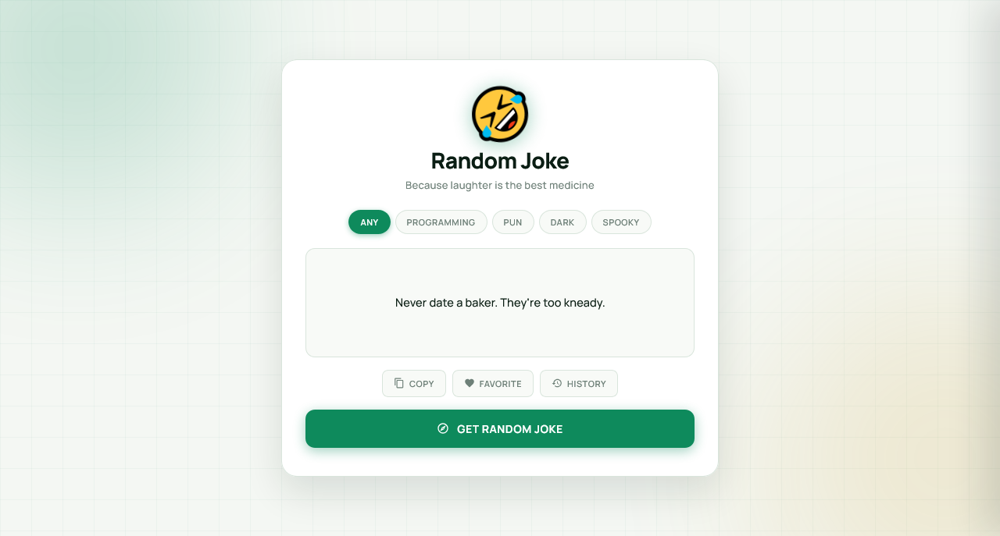

  

<h1 align="center">Random Joke Generator</h1>

  A sleek, fully responsive joke generator built with vanilla JavaScript — featuring category filtering, favorite saving, clipboard copy, history tracking, and a dynamic warm emerald theme.

  
  

> Built while learning JavaScript.

---

## ✨ Features

- **Random jokes on demand** — fetched live from the JokeAPI
- **6 category filters** — Any, Programming, Pun, Dark, Spooky, Christmas
- **Category-specific color themes** — each category has its own palette
- **Dynamic theme propagation** — tabs, joke box glow, button, emoji & border change color together
- **Category-specific emoji sets** — Spooky shows 🎃👻, Christmas shows 🎄🎅, Programming shows 💻🐛
- **Auto theme memory** — remembers your last-used category via localStorage
- **Favorite jokes** — save & manage favorites with localStorage
- **Clipboard copy** — one-click copy with fallback for mobile browsers
- **Joke history** — tracks the last 10 jokes with relative timestamps
- **Individual removal** — remove single items from favorites or history
- **Clear all history** — with custom themed confirmation dialog
- **Custom confirm dialog** — themed replacement for native `confirm()` (keyboard + overlay support)
- **Smooth transitions** — colors fade elegantly when switching categories
- **Loading state** — spinner inside the button and glowing joke-box border
- **Robust fallback** — if a category returns no joke, falls back to "Any"
- **XSS-safe** — all rendered jokes are HTML-escaped
- **Warm emerald aesthetic** — cream background with soft glow orbs
- **Fully responsive** — perfect on mobile (320px+), tablet, and desktop
- **Premium typography** — Manrope + DM Mono

---

## 🎨 Design Highlights

| Element | Style |
|---------|-------|
| **Background** | Warm off-white `#f4f7f3` with subtle green grid |
| **Glow orbs** | Category color (dynamic) + gold `#c89618` (soft) |
| **Card** | Pure white with rounded 20px corners + warm shadow |
| **Title** | Manrope extra-bold |
| **Category tabs** | Pill-shaped with category-active gradient |
| **Joke box** | Cream with category focus glow |
| **Joke text** | Manrope with fade-in animation |
| **Action buttons** | Cream with category hover state |
| **Favorite active** | Gold star state |
| **Main button** | Category-colored gradient (dynamic per category) |
| **Side panel** | White slide-in with category accents |
| **Confirm dialog** | Cream with danger red button |
| **Toast** | Ink dark with success/error variants |

---

## 🎨 Category Color Themes

Each category has its own color identity:

| Category | Color | Accent |
|----------|-------|--------|
| **Any** | Emerald `#0e8a5c` | Green |
| **Programming** | Blue `#3b6fa8` | Blue |
| **Pun** | Gold `#c89618` | Gold |
| **Dark** | Brown `#6b4226` | Brown |
| **Spooky** | Purple `#a05a9b` | Purple |
| **Christmas** | Red `#d96a6a` | Red |

When you switch categories, the **main button**, **active tab**, **joke box glow**, and **glow orb** all transition to the new color together.

---

## 🛠️ Tech Stack

| Technology | Usage |
|------------|-------|
| **HTML5** | Structure & semantic markup |
| **CSS3** | CSS variables, category theming, responsive design (`clamp()`) |
| **JavaScript (Vanilla)** | Async/await fetch, DOM manipulation, state management |
| **localStorage** | Persisting favorites, history & last-used category |
| **JokeAPI** | Free joke API (no key required) — [jokeapi.dev](https://jokeapi.dev) |
| **Google Fonts** | Manrope, DM Mono |

---

## 🐛 Robustness

- **Category-specific flags** — Spooky/Christmas fetched correctly by adjusting filter flags per category
- **Fallback URL** — if the chosen category returns nothing, tries "Any"
- **XSS-safe rendering** — all jokes HTML-escaped before insertion
- **Duplicate handling** — same joke won't repeat in history
- **Auto-theme persistence** — category saved on selection, restored on reload
- **Custom confirm dialog** — replaced native `confirm()` with themed dialog
- **Abort-safe operations** — Esc closes panels without errors
- **localStorage safety** — try/catch wrappers prevent crashes

---

## 🔮 Future Ideas

- [ ] **Speech synthesis** — read jokes aloud
- [ ] **Share button** — native Web Share API on mobile
- [ ] **Bengali translation** — bilingual joke mode
- [ ] **Category statistics** — track which categories you laugh at most
- [ ] **Dark / light theme** toggle
- [ ] **Offline mode** — cache the last fetched joke

---

## 🤝 Contributing

Contributions, issues, and feature requests are welcome!  
Feel free to check the [issues page](https://github.com/abdurrahman101bd/JavaScript/issues).

---

  Made with ❤️ while learning JavaScript

