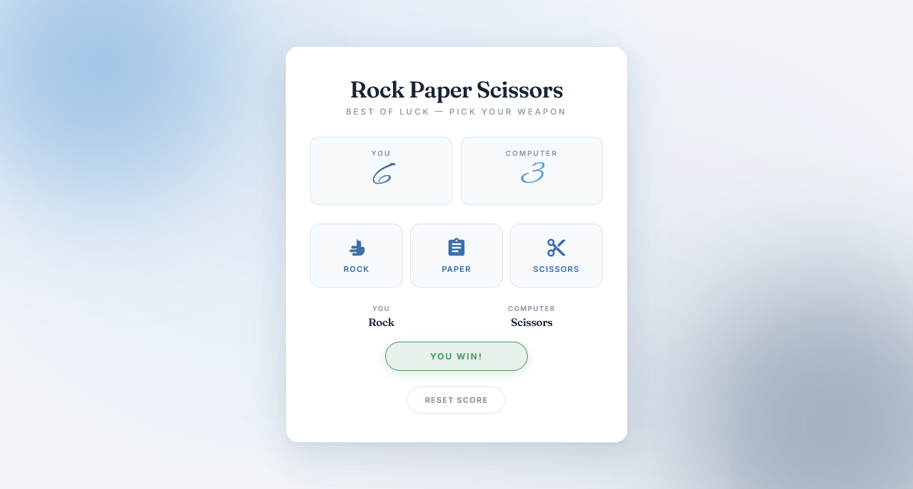

  

<h1 align="center">Rock Paper Scissors</h1>

  A sleek, fully responsive Rock Paper Scissors game built with vanilla JavaScript — featuring live score tracking, animated result badges, custom SVG weapons, and a coastal editorial aesthetic.

  
  

> Built while learning JavaScript.

---

## ✨ Features

- **Classic RPS gameplay** — rock, paper, or scissors against the computer
- **Random computer choice** — fair 1-in-3 odds using `Math.random()`
- **Live score tracking** — You vs Computer, updated instantly per round
- **Animated score bump** — Alex Brush score numbers scale up with a smooth bounce on win
- **Color-coded result badge** — sage green for win, soft red for lose, warm gold for draw
- **Pop animation** — result badge animates in with a bouncy scale
- **Custom SVG weapons** — inline icons instead of external icon fonts
- **Hover lift effect** — weapon buttons lift with a blue glow on hover
- **Reset button** — pill-shaped ghost button to clear score and start fresh
- **Choice preview** — shows both your pick and the computer's pick after each round
- **Coastal editorial aesthetic** — cool blue palette with off-white background
- **Glow orbs in background** — sky blue top-left + deep navy bottom-right, both animated
- **Elegant typography** — Fraunces serif titles + Alex Brush score numbers + Inter body
- **Fully responsive** — perfect on mobile (320px+), tablet, and desktop
- **Premium fonts** — Fraunces + Alex Brush + Inter

---

### 🧠 Outcome Lookup Table

| You ↓ / Comp → | Rock | Paper | Scissors |
|----------------|------|-------|----------|
| **Rock** | Draw | Lose | Win |
| **Paper** | Win | Draw | Lose |
| **Scissors** | Lose | Win | Draw |

---

## 🐛 Robustness

- **ID consistency** — no mismatch between HTML and CSS selectors
- **CSS classes for result** — no inline style manipulation
- **Event listeners** — proper `addEventListener` instead of inline handlers
- **Display names** — "SCISSOR" correctly shown as "Scissors"
- **Bump animations** — score updates trigger a clean bounce
- **Pop animations** — result badge animates in smoothly
- **Reset logic** — clears all state and re-renders

---

## 🔮 Future Ideas

- [ ] **Sound effects** — click + win/lose chime via Web Audio API
- [ ] **Weapon reveal animation** — shake + reveal before showing pick
- [ ] **Match history** — track last 5 rounds
- [ ] **Best of 5 mode** — first to 3 wins takes the match
- [ ] **Countdown timer** — 3 seconds to pick a weapon
- [ ] **Emoji mode** — toggle between SVG icons and emojis
- [ ] **Dark / light theme** toggle

---

## 🤝 Contributing

Contributions, issues, and feature requests are welcome!  
Feel free to check the [issues page](https://github.com/abdurrahman101bd/JavaScript/issues).

---

  Made with ❤️ while learning JavaScript

