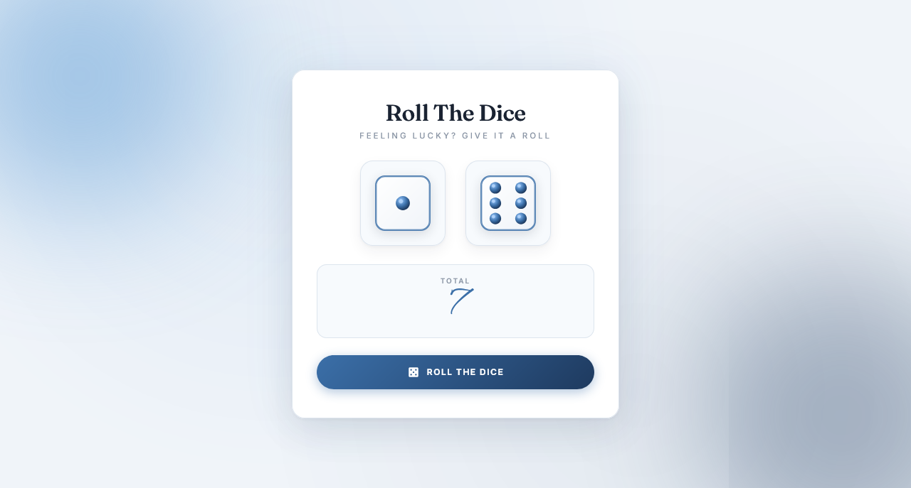

  

<h1 align="center">Roll The Dice</h1>

  A sleek, fully responsive dice roller built with vanilla JavaScript — featuring dual dice shake animation, custom SVG faces, and a coastal editorial aesthetic.

  
  

> Built while learning JavaScript.

---

## ✨ Features

- **Roll two dice at once** — both dice spin together and land on random values
- **Shake animation** — dice wiggle and glow while rolling, then settle on the result
- **Random 1–6 values** — fair, evenly distributed using `Math.random()`
- **Live total display** — sum of both dice shown in elegant Alex Brush script
- **Animated count bump** — total number scales up with a bounce on every roll
- **Custom SVG dice** — white paper face with blue border and blue pips
- **Button state management** — roll button disables during animation to prevent spam
- **Auto-roll on load** — dice roll once automatically when the page opens
- **Shine sweep on button** — light sweeps across the button on hover
- **Coastal editorial aesthetic** — cool blue palette with off-white background
- **Glow orbs in background** — sky blue top-left + deep navy bottom-right
- **Elegant typography** — Fraunces serif titles + Alex Brush total + Inter body
- **Fully responsive** — perfect on mobile (320px+), tablet, and desktop
- **Premium fonts** — Fraunces + Alex Brush + Inter

---

## 🎨 Design Highlights

| Element | Style |
|---------|-------|
| **Background** | Soft cool off-white `#f0f4f9` |
| **Glow orbs** | Sky blue `#5b9bd5` + deep navy `#1e3a5f` |
| **Card** | Pure white paper with blue-tinted shadow |
| **Title** | Fraunces serif (editorial) |
| **Subtitle** | Wide-caps muted gray |
| **Dice slots** | Cream cards with blue border |
| **Rolling state** | Blue border + soft glow |
| **Total display** | Cream card with Alex Brush number |
| **Roll button** | Blue gradient pill with shine sweep |
| **Disabled state** | Cream gray with muted text |

---

## 🎲 Dice Faces

| Element | Color |
|---------|-------|
| **Die body** | White gradient `#ffffff → #f0f4f9` |
| **Border** | Blue `#3b6fa8` |
| **Pips** | Blue gradient `#93c5fd → #1e3a5f` |
| **Pip highlight** | Light blue `#bfdbfe` |
| **Inner border** | Soft blue `#dde5ee` |

---

## 🛠️ Tech Stack

| Technology | Usage |
|------------|-------|
| **HTML5** | Structure & semantic markup |
| **CSS3** | Animations, responsive layout (`clamp()`), grid |
| **JavaScript (Vanilla)** | Roll logic, DOM updates, state management |
| **SVG** | Custom dice faces (1–6) — crisp at any size |
| **Google Fonts** | Fraunces, Alex Brush, Inter |

---

## 🐛 Robustness

- **Total calculation** — fixed string concatenation issue; the total is correctly cast to a number
- **Event listeners** — replaced inline `onclick` with `addEventListener`
- **Spam protection** — roll button locks during the shake animation
- **Auto-roll on load** — first roll happens automatically
- **Bump animation** — clean re-trigger via `offsetWidth` reflow
- **SVG fallback** — all dice faces are local SVGs (no network requests)
- **Responsive sizes** — `clamp()` keeps dice readable on all screens
- **Clean SVG colors** — white body + blue pips match the paper aesthetic

---

## 🔮 Future Ideas

- [ ] **Dice roll sound** — clatter via Web Audio API
- [ ] **Roll history** — track last 10 rolls
- [ ] **Target sum game** — guess the total, win if correct
- [ ] **Individual dice spin** — per-die rotation animation
- [ ] **Multi-dice mode** — roll 3, 4, or 5 dice
- [ ] **Stat tracker** — most frequent total
- [ ] **Dark / light theme** toggle

---

## 🤝 Contributing

Contributions, issues, and feature requests are welcome!  
Feel free to check the [issues page](https://github.com/abdurrahman101bd/JavaScript/issues).

---

  Made with ❤️ while learning JavaScript

