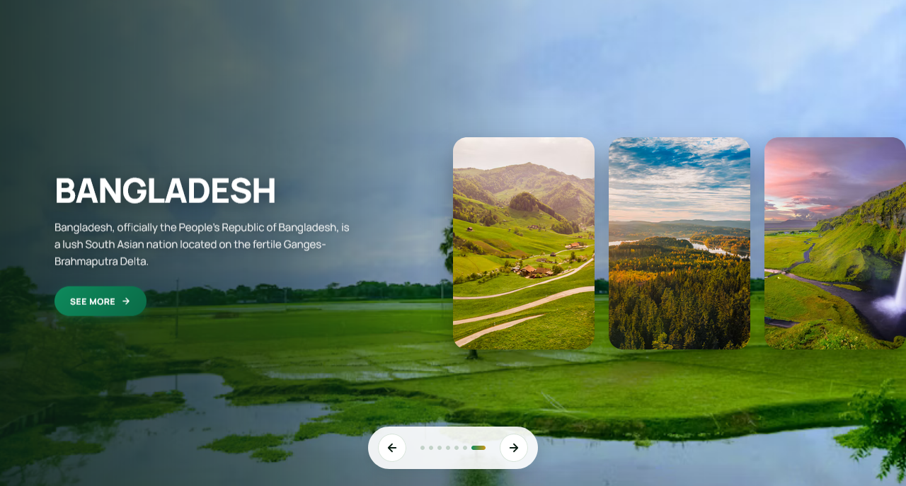

<p align="center">
  
</p>

<h1 align="center">Travel Slider</h1>

<p align="center">
  A sleek, fully responsive travel carousel built with vanilla JavaScript — featuring a full-screen hero, side previews, smooth transitions, and a warm emerald aesthetic.
</p>

<p align="center">
  <a href="https://abdurrahman101bd.github.io/JavaScript/travel-slider">
    
  </a>
  
</p>

> Built while learning JavaScript.

---

## ✨ Features

- **Full-screen hero** — the current slide fills the entire viewport
- **Side previews** — up to 3 upcoming slides shown as cards on the right
- **Smooth transitions** — 0.7s cubic-bezier with DOM reordering
- **Next / Prev navigation** — buttons, keyboard arrows, and touch swipe
- **Clickable dots** — jump to any slide by clicking a dot
- **Animated content** — badge, name, description, and CTA fade in sequentially
- **Glassmorphic control bar** — frosted pill with nav buttons and dots
- **"See More" link** — links directly to the Wikipedia article for each country
- **Fully responsive** — side previews hide on mobile, content repositions to bottom
- **Warm emerald aesthetic** — cream surfaces with emerald + gold accents
- **Subtle hover effects** — nav buttons scale and glow
- **Premium typography** — Manrope + DM Mono

---

## 🎨 Design Highlights

| Element | Style |
|---------|-------|
| **Background** | Dark forest green `#060f0c` |
| **Hero image** | Full-bleed with dual gradient overlays |
| **Hero overlay** | Left-dark gradient for text readability |
| **Bottom overlay** | Dark fade for controls area |
| **Content area** | Left-aligned, max 420px wide |
| **Name** | Manrope extra-bold, uppercase, huge |
| **Description** | Muted white with text shadow |
| **"See More"** | Emerald gradient pill with shine sweep |
| **Preview cards** | 200×300px with 20px radius + heavy shadow |
| **Control bar** | Frosted glass `rgba(255,255,255,0.9)` |
| **Nav buttons** | Circular, emerald gradient on hover |
| **Active dot** | Expands to a 20px emerald-gold pill |

---

### 🎯 The DOM Reordering Trick

Instead of tracking positions manually, the slider **moves** items in the DOM:

```js
nextBtn.addEventListener("click", () => {
  const items = slideEl.querySelectorAll(".item");
  slideEl.appendChild(items[0]);  // first becomes last
});
```

## ⌨️ Controls & Interactions

| Action | Result |
|--------|--------|
| **Click Next** | Advance one slide |
| **Click Prev** | Go back one slide |
| **Arrow Right** | Advance one slide |
| **Arrow Left** | Go back one slide |
| **Swipe right** | Go back one slide |
| **Swipe left** | Advance one slide |
| **Click dot** | Jump to that slide |
| **Click "See More"** | Opens Wikipedia article in new tab |

---

## 🐛 Robustness

- **DOM reordering** — no manual position tracking, browser handles layout
- **Pointer events** — `pointer-events: none` on hidden items prevents accidental taps
- **Touch swipe** — 50px threshold prevents accidental triggers
- **Keyboard support** — Arrow keys work globally (no focus needed)
- **Dot jumping** — chains multiple next/prev operations cleanly
- **Animation stagger** — badge → name → desc → CTA with delays
- **Hero fallback** — `nth-child(1)` and `nth-child(2)` both work as hero (rotation-safe)

---

## 🔮 Future Ideas

- [ ] **Auto-play** — advance every 5s
- [ ] **Pause on hover** — stop auto-play when hovering
- [ ] **Thumbnail strip** — full horizontal preview bar
- [ ] **Fullscreen mode** — toggle button to hide controls
- [ ] **Progress indicator** — timeline bar showing position
- [ ] **Image preloading** — avoid blank flash on slow connections
- [ ] **Multiple transitions** — slide, fade, zoom options
- [ ] **3D flip transition** — Y-axis rotation effect

---

## 🤝 Contributing

Contributions, issues, and feature requests are welcome!  
Feel free to check the [issues page](https://github.com/abdurrahman101bd/JavaScript/issues).

---

<p align="center">
  Made with ❤️ while learning JavaScript
</p>