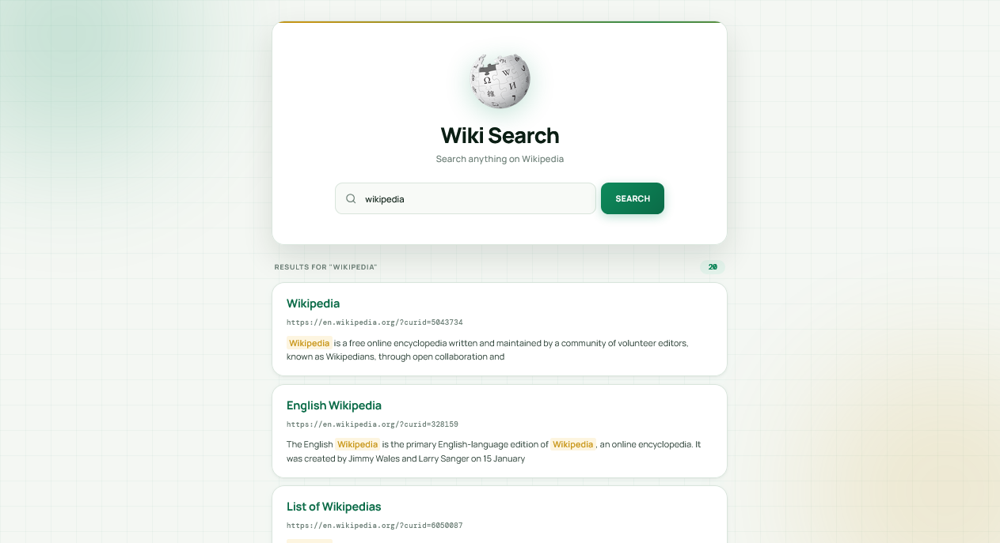

<p align="center">
  
</p>

<h1 align="center">Wiki Search</h1>

<p align="center">
  A sleek, fully responsive Wikipedia search app built with vanilla JavaScript — featuring live API queries, skeleton loading, and a warm emerald aesthetic.
</p>

<p align="center">
  <a href="https://abdurrahman101bd.github.io/JavaScript/wiki-search">
    
  </a>
  
</p>

> Built while learning JavaScript.

---

## ✨ Features

- **Instant Wikipedia search** — queries the official Wikipedia API
- **Up to 20 results** — fetches the top matching articles
- **Search match highlighting** — matched terms highlighted in gold within snippets
- **Skeleton loading** — 3 shimmer cards shown while fetching
- **Empty state** — book icon + helpful prompt shown before search
- **Error states** — distinct messages for empty search, no results, and network errors
- **Results header** — shows the current query + result count badge
- **Frosted result cards** — rounded cards with hover lift and emerald border
- **Click-to-open** — any card opens the Wikipedia article in a new tab
- **Fully responsive** — perfect on mobile (320px+), tablet, and desktop
- **Warm emerald aesthetic** — cream background with soft glow orbs
- **Subtle grid background** — faint green blueprint lines
- **Premium typography** — Manrope + DM Mono

---

## 🎨 Design Highlights

| Element | Style |
|---------|-------|
| **Background** | Warm off-white `#f4f7f3` with subtle green grid |
| **Glow orbs** | Emerald `#0e8a5c` + gold `#c89618` (soft) |
| **Hero card** | White with animated gradient top line |
| **Wiki logo** | Wikipedia mark in a rounded square |
| **Search input** | Cream with emerald focus glow |
| **Search button** | Emerald gradient with spinner |
| **Results cards** | White rounded with hover lift + emerald border |
| **Result title** | Manrope bold in emerald-dark |
| **Result URL** | DM Mono in muted gray, gold on hover |
| **Snippet** | Manrope with gold-highlighted matches |
| **Error state** | Red card with icon + message |
| **Count badge** | Emerald pill with monospace count |

---

### 🔍 Wikipedia API

```
https://en.wikipedia.org/w/api.php
  ?action=query
  &list=search
  &prop=info
  &inprop=url
  &utf8=
  &format=json
  &origin=*
  &srlimit=20
  &srsearch=<query>
```

Returns up to **20 results** with titles, snippets, and page IDs. Each result is linked using `?curid=<pageid>`.

---

## 🐛 Robustness

- **URL-encoded queries** — `encodeURIComponent(query)` prevents injection
- **Empty search guard** — shows error card if input is blank
- **Zero results** — distinct "No results" error message
- **Network error handling** — try/catch wraps the fetch call
- **XSS-safe rendering** — result titles HTML-escaped before insertion
- **Loading state** — button disables + spinner during fetch
- **Skeleton loading** — 3 shimmer cards appear instantly
- **`isLoading` guard** — prevents overlapping searches
- **Wiki snippet markup** — `<span class="searchmatch">` preserved and styled in gold

---

## 🔮 Future Ideas

- [ ] **Search suggestions** — autocomplete as you type
- [ ] **Result preview** — open in modal instead of new tab
- [ ] **Recent searches** — saved via localStorage
- [ ] **Category filters** — people, places, concepts
- [ ] **Language selector** — search Wikipedia in different languages
- [ ] **Dark mode toggle**
- [ ] **Pagination** — load more than 20 results
- [ ] **Image preview** — thumbnail of article lead image

---

## 🤝 Contributing

Contributions, issues, and feature requests are welcome!  
Feel free to check the [issues page](https://github.com/abdurrahman101bd/JavaScript/issues).

---

<p align="center">
  Made with ❤️ while learning JavaScript
</p>